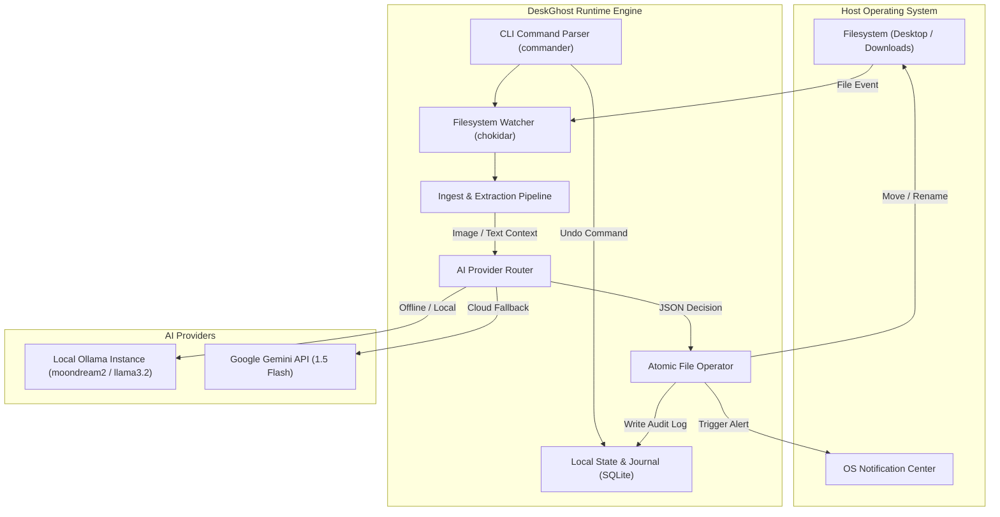
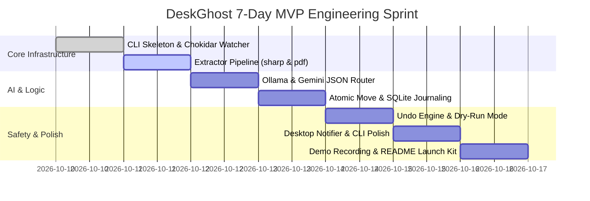

# Software Requirements Specification (SRS)
## Project: DeskGhost 👻
**Version:** 1.0.0  
**Status:** Approved for Implementation  
**Target Audience:** Engineering, Open-Source Contributors, Product Developers  

---

## 1. Introduction

### 1.1 Purpose
Dokumen ini mendefinisikan spesifikasi kebutuhan perangkat lunak (Software Requirements Specification) untuk **DeskGhost**, sebuah agen otomatisasi latar belakang (background agent) berbasis *local-first multimodal AI* yang mengorganisir, mengklasifikasikan secara semantik, dan mengganti nama file pada folder `Desktop` dan `Downloads` secara otonom dengan jaminan keamanan transaksi (*atomic undo*).

### 1.2 Scope
DeskGhost dirancang sebagai *developer tool* / *power-user utility* cross-platform (macOS, Windows, Linux) yang didistribusikan via npm (`npx deskghost`). Sistem ini beroperasi secara non-intrusif di latar belakang, memantau penambahan file baru, menganalisis isi konten visual dan tekstual menggunakan model AI lokal (Ollama) dengan fallback API cloud (Gemini 1.5 Flash), serta memindahkan file ke hierarki direktori yang terstruktur tanpa risiko kehilangan data.

### 1.3 Definitions, Acronyms & Abbreviations
* **LLM:** Large Language Model.
* **VLM:** Vision-Language Model (model multimodal pemroses gambar dan teks).
* **TTV:** Time to Value (waktu dari instalasi hingga melihat manfaat produk).
* **Atomic Operation:** Operasi sistem berkas yang selesai secara tuntas atau tidak dijalankan sama sekali, mencegah kondisi *corrupt* atau data hilang sebagian.
* **Debounce:** Penundaan pemrosesan event berkas hingga aliran penulisan data selesai.

---

## 2. Overall Description

### 2.1 Product Perspective
DeskGhost adalah utilitas CLI berbasis daemon yang mandiri (*standalone*), berinteraksi langsung dengan sistem berkas lokal pengguna dan mesin AI.



### 2.2 User Personas
1. **The Overwhelmed Developer / Power User:** Memiliki puluhan tangkapan layar, CSV, dan installer di Desktop; membutuhkan lingkungan kerja rapi tanpa repot memilah berkas manual.
2. **The Privacy-Conscious Tinkerer:** Ingin merapikan dokumen sensitif (slip gaji, bukti bayar) tanpa mengunggah data pribadi ke cloud komersial.
3. **The Casual Professional:** Menginginkan kemudahan 1-klik untuk membersihkan folder unduhan dengan opsi rollback instan jika ada kesalahan klasifikasi.

---

## 3. System Architecture & Components

### 3.1 Component Breakdown
1. **CLI & Process Daemon (`src/cli/`):** Menyediakan antarmuka baris perintah (`start`, `organize`, `undo`, `history`, `config`).
2. **FS Watcher & Debouncer (`src/watcher/`):** Menggunakan `chokidar` untuk mendeteksi event berkas baru dengan filter debounce (default 3000ms) untuk memastikan berkas selesai diunduh.
3. **Extractor Module (`src/extractors/`):**
   * *Image Extractor:* Resize otomatis gambar berukuran besar menggunakan `sharp` sebelum dianalisis visual.
   * *PDF Extractor:* Ekstraksi teks dari dokumen PDF menggunakan `pdf-parse`.
   * *Generic Text Extractor:* Ekstraksi cuplikan teks dari CSV, JSON, Markdown, dan file teks polos.
4. **AI Reasoning Engine (`src/ai/`):** Mengirimkan data terstruktur ke model dan mewajibkan respon berformat JSON terstruktur (*Strict JSON Schema*).
5. **Atomic Transaction & Journal Engine (`src/storage/`):** Mengelola database SQLite (`better-sqlite3`) yang menyimpan riwayat nama lama, nama baru, checksum berkas, dan waktu aksi.
6. **Notification Subsystem (`src/notifier/`):** Mengirimkan notifikasi desktop natif via `node-notifier`.

---

## 4. Functional Requirements

| Req ID | Kategori | Deskripsi Kebutuhan |
| :--- | :--- | :--- |
| **FR-01** | **File Monitoring** | Sistem harus dapat memantau satu atau beberapa direktori yang ditentukan pengguna (default: Desktop dan Downloads). |
| **FR-02** | **Debounce & Lock Detection** | Sistem harus menunda pemrosesan jika berkas masih berekstensi sementara (misal `.crdownload`, `.part`, `.tmp`) hingga penulisan berkas selesai. |
| **FR-03** | **Multimodal Extraction** | Sistem harus mampu mengekstrak teks dari PDF/dokumen dan memproses gambar menggunakan model visual AI. |
| **FR-04** | **Structured AI Classification** | Sistem harus meminta LLM menghasilkan output JSON: `{ "suggestedName": string, "category": string, "reason": string, "confidence": number }`. |
| **FR-05** | **Collision Handling** | Jika berkas tujuan sudah ada, sistem tidak boleh menimpa (overwrite) file yang ada. Sistem harus menambahkan penomoran otomatis `(1)`, `(2)`, dst. |
| **FR-06** | **Atomic Undo** | Sistem harus menyediakan perintah `deskghost undo [--last N]` yang membalikkan aksi pemindahan dan penggantian nama berkas 100% ke kondisi awal berdasarkan riwayat di database. |
| **FR-07** | **Dry-Run Mode** | Sistem harus menyediakan flag `--dry-run` untuk mencetak rencana aksi ke terminal tanpa menyentuh sistem berkas pengguna. |
| **FR-08** | **Local & Cloud Support** | Sistem harus mendukung Ollama secara default (offline) dan API key Gemini/OpenAI sebagai alternatif. |

---

## 5. Non-Functional Requirements

### 5.1 Performance & Resource Limits
* **Latency:** Klasifikasi berkas lokal harus selesai dalam waktu < 3 detik untuk model ringan (`moondream2`) dan < 1 detik untuk cloud (`gemini-1.5-flash`).
* **Memory Footprint:** Proses background daemon Node.js tidak boleh mengonsumsi lebih dari 90 MB RAM saat idle.
* **CPU Usage:** CPU idle di bawah 0.5%; pemrosesan ekstraksi gambar harus menerapkan pembatasan konkurensi (maksimal 2 berkas paralel).

### 5.2 Privacy & Security
* Berkas tidak boleh dikirim ke server pihak ketiga manapun jika mode `provider: "ollama"` diaktifkan.
* File biner berformat rahasia (kunci SSH, `.env`, `.pem`) wajib masuk dalam default ignore list dan tidak boleh dibaca oleh AI engine.

### 5.3 Cross-Platform Compatibility
* Mendukung penuh sistem operasi macOS (Sonoma ke atas), Windows 10/11, dan Linux (Ubuntu 22.04+).
* Normalisasi path berkas harus menggunakan pemisah path standar OS (`path.resolve`).

---

## 6. Database Schema (SQLite)

Database disimpan secara lokal di `~/.deskghost/deskghost.db`.

```sql
CREATE TABLE IF NOT EXISTS file_actions (
    id INTEGER PRIMARY KEY AUTOINCREMENT,
    action_batch_id TEXT NOT NULL,
    original_path TEXT NOT NULL,
    new_path TEXT NOT NULL,
    file_name_original TEXT NOT NULL,
    file_name_new TEXT NOT NULL,
    file_hash TEXT,
    category TEXT,
    ai_reason TEXT,
    provider_used TEXT,
    timestamp DATETIME DEFAULT CURRENT_TIMESTAMP,
    status TEXT CHECK(status IN ('MOVED', 'REVERTED', 'FAILED')) DEFAULT 'MOVED'
);

CREATE INDEX IF NOT EXISTS idx_batch ON file_actions(action_batch_id);
CREATE INDEX IF NOT EXISTS idx_status ON file_actions(status);
```

---

## 7. Safety & Exception Handling

1. **Permission Denied:** Jika sistem gagal membaca/menulis berkas karena proteksi OS, catat error di log terminal tanpa mematikan daemon utama.
2. **Missing Source on Undo:** Jika pengguna sudah menghapus atau memindahkan file secara manual sebelum menjalankan `undo`, laporkan notifikasi *"File target sudah dimodifikasi secara eksternal; operasi dibatalkan untuk mencegah korupsi data"*.
3. **AI Fallback:** Jika Ollama tidak aktif (offline), sistem otomatis mencoba provider cadangan yang terkonfigurasi (Gemini API) atau menahan berkas tanpa aksi merusak.

---

## 8. 7-Day Sprint Plan (MVP Implementation)


